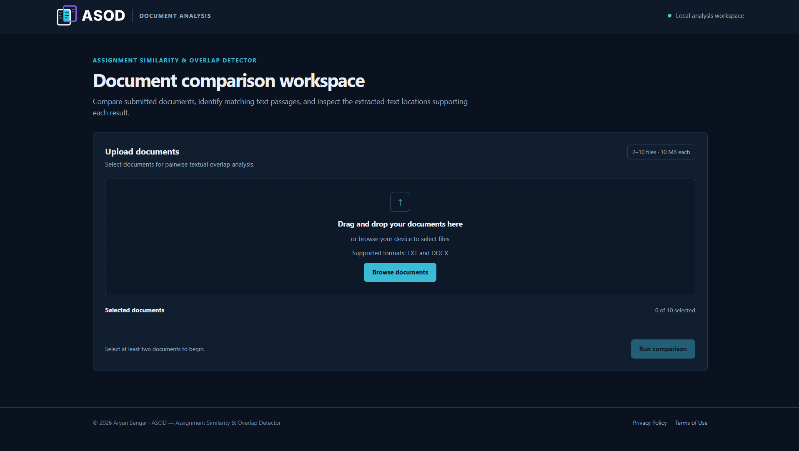

<div align="center">

<!-- ╔══════════════════════════════════════════════════════════════╗ -->
<!--                   ANIMATED WAVE HEADER                         -->
<!-- ╚══════════════════════════════════════════════════════════════╝ -->


<!-- ╔══════════════════════════════════════════════════════════════╗ -->
<!--                  ANIMATED TYPING TAGLINE                       -->
<!-- ╚══════════════════════════════════════════════════════════════╝ -->


<br/>


<br/>

<!-- ╔══════════════════════════════════════════════════════════════╗ -->
<!--                      CTA BUTTONS                               -->
<!-- ╚══════════════════════════════════════════════════════════════╝ -->

[](https://github.com/aryansengar007/ASOD)
[](https://aryan-sengar-portfolio-v2.netlify.app/)

<br/>

<!-- ╔══════════════════════════════════════════════════════════════╗ -->
<!--               ANIMATED SKILL / TECH ICON BADGES                -->
<!-- ╚══════════════════════════════════════════════════════════════╝ -->


<br/><br/>


</div>

<br/>

<!-- ━━━━━━━━━━━━━━━━━━━━━━━━━━━━ WAVE DIVIDER ━━━━━━━━━━━━━━━━━━━━━━━━━━━━ -->


<br/>

<!-- ╔══════════════════════════════════════════════════════════════╗ -->
<!--                      Dashboard Preview                              -->
<!-- ╚══════════════════════════════════════════════════════════════╝ -->

<div align="center">



</div>

<br/>

<!-- ━━━━━━━━━━━━━━━━━━━━━━━━━━━━ WAVE DIVIDER ━━━━━━━━━━━━━━━━━━━━━━━━━━━━ -->


<br/>

<!-- ╔══════════════════════════════════════════════════════════════╗ -->
<!--                     ABOUT THE PROJECT                          -->
<!-- ╚══════════════════════════════════════════════════════════════╝ -->

## 📚 About The Project

**ASOD (Assignment Similarity & Overlap Detector)** is a document comparison project that helps identify textual reuse across multiple submitted documents. It is built with a **FastAPI** backend and a plain **HTML**, **CSS** and **JavaScript** frontend.

Users upload TXT and DOCX files, compare them pairwise, and inspect detected exact token-sequence matches and potential near-copy regions.

Instead of presenting a single similarity score as a plagiarism verdict, ASOD provides extracted text passages, character offsets, and supporting comparison evidence for human examination.

> 🤝 Built around one idea: the tool gathers evidence, and a person makes the judgement. Textual overlap is not automatically plagiarism, and results do not establish authorship, intent, or academic misconduct.

<br/>

<div align="center">

| 🔎 Evidence First | 🧮 Token Alignment | 📄 Two Formats | 🧑‍⚖️ Human Review |
|:---:|:---:|:---:|:---:|
| Passages and offsets, not a bare score | Exact and near-copy lexical overlap | TXT and DOCX extraction | Every result needs interpretation in context |

</div>

<br/>

<!-- ━━━━━━━━━━━━━━━━━━━━━━━━━━━━ WAVE DIVIDER ━━━━━━━━━━━━━━━━━━━━━━━━━━━━ -->


<br/>

<!-- ╔══════════════════════════════════════════════════════════════╗ -->
<!--                        FEATURES                                -->
<!-- ╚══════════════════════════════════════════════════════════════╝ -->

## ✨ Features

<br/>

| 📥 Input & Validation | ⚙️ Comparison Engine | 🔍 Evidence & Review |
|:---|:---|:---|
| **Multi-document upload** of 2 to 10 documents | **Pairwise comparison** of every unique document pair | **Evidence inspection** with matching source and target passages |
| **Supported formats:** TXT and DOCX | **Exact overlap detection** of matching contiguous token sequences | **Character offsets** showing where evidence sits in the extracted text |
| **Input validation** for file type, file size and document count | **Near-copy detection** of regions with partial or interrupted lexical matches | **Supporting statistics** displayed next to each match |
| Text extracted with `python-docx` for DOCX files | Token-based sequence alignment, no black box score | Interface designed for a reviewer to read the original context |

<br/>

### 📌 The Flow

```
Upload 2 to 10 documents  (TXT or DOCX)
   │
   ▼
Text extraction  (per document)
   │
   ▼
Pairwise comparison  (every unique pair)
   │
   ▼
Token alignment  ──▶  Exact matches + candidate near-copy regions
   │
   ▼
Interface shows passages, offsets and statistics
   │
   ▼
A human reviewer interprets the evidence in context
```

<br/>

<!-- ━━━━━━━━━━━━━━━━━━━━━━━━━━━━ WAVE DIVIDER ━━━━━━━━━━━━━━━━━━━━━━━━━━━━ -->


<br/>

<!-- ╔══════════════════════════════════════════════════════════════╗ -->
<!--                        TECH STACK                              -->
<!-- ╚══════════════════════════════════════════════════════════════╝ -->

## 🛠️ Tech Stack

<br/>

<div align="center">


<br/><br/>

| Layer | Technology | Purpose |
|:---:|:---|:---|
| 🐍 **Backend** | Python, FastAPI | API endpoints and comparison workflow |
| 🚀 **API Server** | Uvicorn | Runs the FastAPI application |
| 📄 **Extraction** | python-docx | Reads text from DOCX files |
| 🔤 **Text Processing** | regex | Tokenisation and text handling |
| 🧮 **Comparison** | Token-based sequence alignment | Finds exact and near-copy overlap |
| 🎨 **Frontend** | HTML, CSS, JavaScript | Upload form and evidence viewer |
| 🧪 **Testing** | pytest | Loader, comparison service and API tests |

</div>

<br/>

<!-- ━━━━━━━━━━━━━━━━━━━━━━━━━━━━ WAVE DIVIDER ━━━━━━━━━━━━━━━━━━━━━━━━━━━━ -->


<br/>

<!-- ╔══════════════════════════════════════════════════════════════╗ -->
<!--                     PROJECT STRUCTURE                          -->
<!-- ╚══════════════════════════════════════════════════════════════╝ -->

## 📁 Project Structure

```
ASOD/
│
├── 📂 benchmark/
│   ├── 📂 schemas/
│   │   ├── ai_annotation.schema.json
│   │   ├── benchmark_metadata.schema.json
│   │   ├── document.schema.json
│   │   ├── document_pair.schema.json
│   │   └── overlap.schema.json
│   ├── 📂 scripts/
│   └── 📜 ANNOTATION_PROTOCOL.md
│
├── 📂 frontend/
│   ├── 📂 assets/
│   │   ├── asod-logo-1.svg
│   │   └── asod-logo-2.svg
│   ├── 📄 index.html                ← Upload and evidence interface
│   ├── 🔒 privacy.html              ← Privacy page
│   └── 📜 terms.html                ← Terms page
│
├── 📂 src/
│   ├── 📂 api/
│   │   └── 🧠 main.py               ← FastAPI application
│   ├── 📂 overlap/
│   │   ├── comparison_service.py    ← Pairwise comparison
│   │   └── token_alignment.py       ← Exact and near-copy alignment
│   ├── 📂 preprocessing/
│   │   ├── document_loader.py       ← TXT and DOCX extraction
│   │   └── pan_loader.py            ← PAN-PC-11 corpus loader
│   └── 📂 similarity/
│
├── 📂 tests/
├── 📄 DATASET_ACQUISITION_REGISTER.md
├── 📄 dataset_card.md
├── 📜 LICENSE
└── 📘 README.md
```

<br/>

<!-- ━━━━━━━━━━━━━━━━━━━━━━━━━━━━ WAVE DIVIDER ━━━━━━━━━━━━━━━━━━━━━━━━━━━━ -->


<br/>

<!-- ╔══════════════════════════════════════════════════════════════╗ -->
<!--                      GETTING STARTED                           -->
<!-- ╚══════════════════════════════════════════════════════════════╝ -->

## 🚀 Getting Started

**1. Clone the repository**

```bash
git clone https://github.com/aryansengar007/ASOD.git
```

**2. Navigate into the project folder**

```bash
cd ASOD
```

**3. Install the core application dependencies**

```bash
python -m pip install fastapi uvicorn python-multipart python-docx regex
```

**4. Start the application** (from the project root)

```bash
python -m uvicorn src.api.main:app --reload
```

**5. Open ASOD**

```
http://127.0.0.1:8000
```

> 📖 The FastAPI interactive API documentation is available at `http://127.0.0.1:8000/docs`.

<br/>

### 🧪 Running Tests

Install the test dependencies:

```bash
python -m pip install pytest httpx
```

Run the core application tests:

```bash
python -m pytest tests/test_document_loader.py tests/test_comparison_service.py tests/test_api.py -v
```

<br/>

<!-- ━━━━━━━━━━━━━━━━━━━━━━━━━━━━ WAVE DIVIDER ━━━━━━━━━━━━━━━━━━━━━━━━━━━━ -->


<br/>

<!-- ╔══════════════════════════════════════════════════════════════╗ -->
<!--                  SCOPE AND LIMITATIONS                         -->
<!-- ╚══════════════════════════════════════════════════════════════╝ -->

## 🧩 Current Scope & Limitations

| ✅ Supported | ⚠️ Not Included |
|:---|:---|
| TXT and DOCX text extraction | PDF extraction and OCR |
| Lexical overlap and token alignment | Semantic paraphrase detection |
| Exact and near-copy candidate regions | AI-generated-text detection in the upload-and-compare workflow |
| Character offsets within extracted text | Original DOCX page positions (offsets refer to extracted text only) |

> 💡 **Key takeaway:** Detected evidence always requires human interpretation. ASOD points a reviewer to the passages worth reading, and the reviewer decides what they mean.

<br/>

<!-- ━━━━━━━━━━━━━━━━━━━━━━━━━━━━ WAVE DIVIDER ━━━━━━━━━━━━━━━━━━━━━━━━━━━━ -->


<br/>

<!-- ╔══════════════════════════════════════════════════════════════╗ -->
<!--                      RESEARCH DATASET                          -->
<!-- ╚══════════════════════════════════════════════════════════════╝ -->

## 🔬 Research Dataset

The project also contains benchmark preparation and evaluation work involving the **PAN-PC-11** plagiarism corpus.

The benchmark documentation records dataset provenance, annotation handling, and evaluation methodology. See `DATASET_ACQUISITION_REGISTER.md`, `dataset_card.md` and `benchmark/ANNOTATION_PROTOCOL.md`.

> 📌 Research retrieval experiments are separate from the current user-upload comparison workflow.

<br/>

<!-- ━━━━━━━━━━━━━━━━━━━━━━━━━━━━ WAVE DIVIDER ━━━━━━━━━━━━━━━━━━━━━━━━━━━━ -->


<br/>

<!-- ╔══════════════════════════════════════════════════════════════╗ -->
<!--                     AUTHOR & CONNECT                           -->
<!-- ╚══════════════════════════════════════════════════════════════╝ -->

## 👨‍💻 Author

<div align="center">

### Aryan Sengar

🎓 **B.Tech CSE (AI & ML)**

<br/>

[](https://www.linkedin.com/in/aryan-sengar-786b96290/)
[](https://github.com/aryansengar007)
[](https://aryan-sengar-portfolio-v2.netlify.app/)
[](https://leetcode.com/u/aryan_sengar007/)

</div>

<br/>

<!-- ╔══════════════════════════════════════════════════════════════╗ -->
<!--                   ANIMATED WAVE FOOTER                         -->
<!-- ╚══════════════════════════════════════════════════════════════╝ -->


<div align="center">

**ASOD: Assignment Similarity & Overlap Detector**

© 2026 **Aryan Sengar** | Released under the terms of the [LICENSE](LICENSE) file.

<br/>

*Textual overlap is evidence for review, not a verdict. If you found this project useful, consider leaving a* ⭐

</div>
